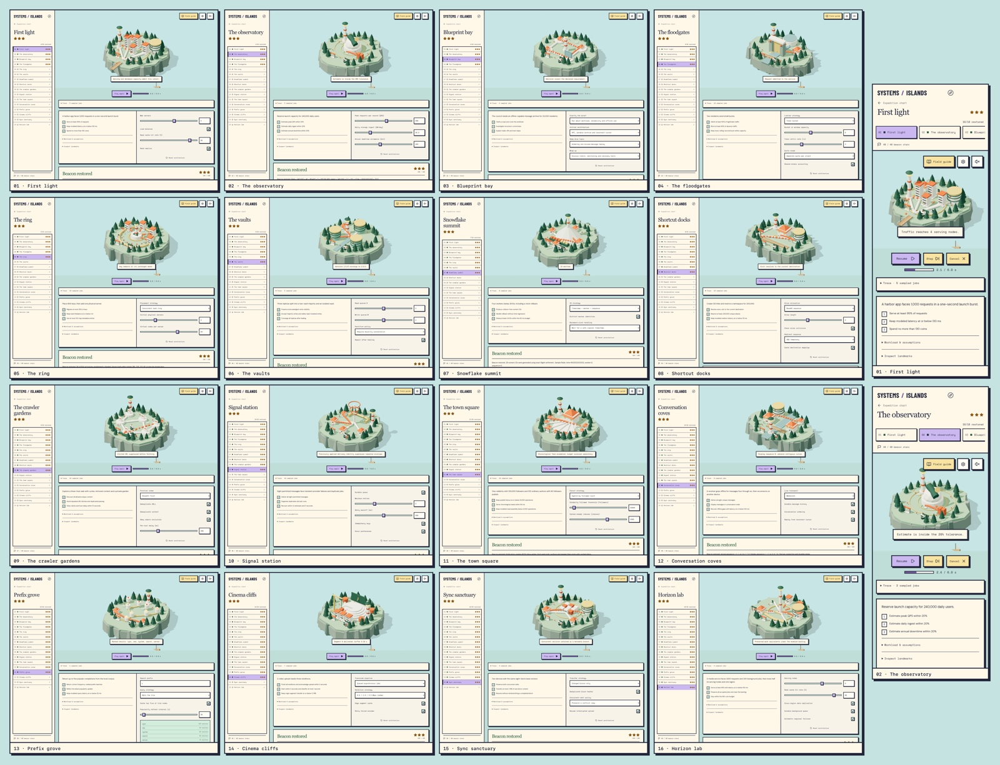

# Systems / Islands

A playable 3D expedition through sixteen systems-design chapters. Each island is an original educational mission in an editable Blender-authored world: explore the architecture, change its configuration, run a traffic trial, and restore its beacon.

React, Three.js and Motion power the game. A minimal retro interface keeps the miniature worlds in view, with deeper explanations in the field guide. Proportionate visitors, operators, couriers and technicians use visible entrances, reserved exterior workstations and exits. During a trial they follow chapter-specific operations: admission, storage, retries, handoffs, rejection and recovery. Configuration changes affect staffing and routes; unsuccessful trials trigger chapter-specific outages and damage.



[Full-resolution PNG](output/share/systems-islands-grid-full.png) · [Shareable JPG](output/share/systems-islands-grid-share.jpg) · [Clickable screenshot grid](output/preview-grid.html)

## Download and play

The [v1.1.0 release](https://github.com/juancarlosf2/systems-islands/releases/tag/v1.1.0) packages the game and screenshot grid:

| File | Use |
| --- | --- |
| [systems-islands-offline.html](https://github.com/juancarlosf2/systems-islands/releases/download/v1.1.0/systems-islands-offline.html) | Download and open directly in a modern browser. No server or internet connection is required. |
| [systems-islands-static.zip](https://github.com/juancarlosf2/systems-islands/releases/download/v1.1.0/systems-islands-static.zip) | Conventional static-site output with dependency notices, for your own hosting. |
| [systems-islands-grid-full.png](https://github.com/juancarlosf2/systems-islands/releases/download/v1.1.0/systems-islands-grid-full.png) | Full-resolution screenshot grid. |
| [systems-islands-grid-share.jpg](https://github.com/juancarlosf2/systems-islands/releases/download/v1.1.0/systems-islands-grid-share.jpg) | Smaller screenshot grid for sharing. |

The specifically named **`systems-islands-offline.html`** embeds the game, fonts, styles, all sixteen GLB worlds and the maintenance crew. The ordinary **`dist/index.html` needs static hosting**; use the offline edition for direct `file://` play. GitHub stores the source and release downloads; these links do not represent a hosted game. See [deployment instructions](docs/DEPLOYMENT.md) to host it yourself.

No account, backend, remote API, analytics or CDN is used. Progress and settings are saved locally when the browser permits localStorage. File-origin storage varies by browser; unavailable storage keeps progress for the current session.

## How to play

- Select a world on the chart or a chapter in the rail, then press **Play beneath the render** to enter it. Every chapter is available from the start.
- Drag the world to orbit, scroll/pinch to zoom, and click a landmark to inspect it. Landmark buttons also provide keyboard access.
- Change the architecture controls, or inspect a site to stage a policy change, then press **Play** to start its six-second trial. **Pause**, **Step**, **Resume** and **Cancel** control the presentation; configuration stays locked throughout the run. Passing all three objectives restores the beacon and awards one to three stars.
- Open **Trace** to follow a sampled job and inspect its operations. After a trial, scrub or step through the trace. Domain timestamps describe the teaching model; the six-second animation uses illustrative pacing. At most ten representative jobs are drawn, while aggregate counters include the full declared workload.
- Earn a beacon on all sixteen islands to complete the expedition. Visiting an island alone does not count as completion.
- `R` runs a trial, `G` opens the field guide, and `C` returns to the chart. Shortcuts pause while typing or while a dialog is open. Tab/Shift+Tab and Enter operate native controls; Escape closes dialogs.
- Settings control sound and reduced motion. Sound starts after user interaction. The game setting and operating-system preference both reduce motion. Reset expedition asks for confirmation and keeps settings.

Motion animates panels, headings, dialogs, results and button feedback. Inputs update immediately, and leaving a chapter cancels its active trial.

## Build locally

Use **Node 24.12+ on the 24.x line or Node 22.20+ on the 22.x line**, with npm, for the checked-in lockfile. The installed Vite and React plugin themselves require Node 20.19+ on the 20.x line or Node 22.12+; an optional Linux dependency has the higher requirement above. Blender is needed only to edit or regenerate the art.

```sh
git clone https://github.com/juancarlosf2/systems-islands.git
cd systems-islands
npm ci
npm run dev
```

Development preview: `http://localhost:5173`. In another terminal, run the checks and build:

```sh
npm test
npm run validate:assets
npm run validate:crew
npm run build
```

`npm run build` produces both the conventional site in `dist/` and `dist/systems-islands-offline.html`. `npm run preview` serves the conventional build locally. Exported models and eighteen native Blender scenes are included; no external model download or source-book PDF is needed to build.

## Chapters and source

The chapter route covers scaling, estimation, design frameworks, rate limiting, consistent hashing, key-value stores, unique IDs, URL shortening, web crawling, notifications, feeds, chat, autocomplete, video delivery, file sync and continuing study. Chapter 16 is an original combined-service capstone with regional failure, durable work and a budget.

The sequence follows the supplied sixteen-chapter edition of Alex Xu's *System Design Interview: An Insider's Guide*. All missions, explanations and scenarios are original. The reference PDF and extracted full text are excluded from the public repository. The capstone is an original exercise, rather than an exercise reproduced from the book.

- [Game plan](docs/GAME_PLAN.md): chapter missions, asset contracts, shared interfaces and design decisions.
- [Playable interactions](docs/PLAYABLE_INTERACTIONS.md): implemented rules, site actions, job playback and remaining extensions.
- [Interaction roadmap](docs/INTERACTION_ROADMAP.md): the wider interaction plan and measured rendering foundation.
- [Validation evidence](docs/VALIDATION.md): recorded gameplay, asset, navigation, offline and interface checks, with coverage limits.
- [Contributing](docs/CONTRIBUTING.md): module responsibilities, simulation changes and Blender editing/export.
- [Deployment](docs/DEPLOYMENT.md): static hosting and the portable edition.
- [Visual specification](docs/design/visual-spec.md): world styling and the minimal retro interface.

## Practical limits

Metrics come from deterministic educational simulations with invented workloads and explicit capacity assumptions. They are not measurements of production services or browser benchmarks. Models use finite request traces, simplified quorum/version selection, logical clock waiting, a miniature web graph, deduplicated provider attempts, a local trie, segment-buffer calculations and hash-based file-block comparisons. The guide and debrief explain their assumptions and trade-offs.

WebGL and a modern browser are required for the 3D world. If a renderer cannot be created, the UI reports the limitation and retains chapter controls and field notes. Responsive browser checks do not establish physical-phone testing or compatibility with every browser. Worker navigation uses authored conservative geometry rather than a rigid-body physics simulation. Local progress is tied to the browser's storage and is not synced between devices.

Dependency licenses remain with their respective authors; retain the supplied [third-party notices](public/THIRD_PARTY_NOTICES.txt) when distributing the release.
